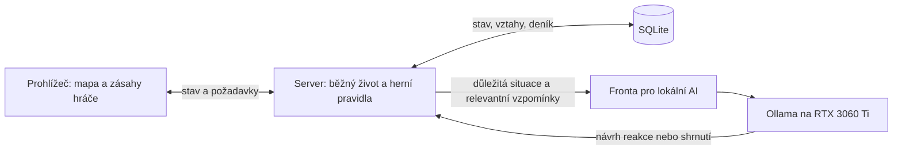

# Minilidi — herní koncept a proveditelnost

## Stav prototypu

**Hotovo:** dvě souběžné vesnice, izometrická mapa s jedním pohledem, vztahy a vzpomínky, vnuknutí, víra, strach, důvěra, hnutí, zázraky, rodiny a svatby, narození a úmrtí, krize a týdenní souhrny. Obyvatelé mají potřeby Jídlo, Energie a Zábava. Využívají oborové dovednosti a hra zaznamenává skutečný podíl modelu na rozhodování.

**Částečně:** z navržené obživy fungují pole, zvířata, lesní sběr, rybolov, kácení a těžba kamene. Budovy přibývají podle pevného pořadí, materiálu a člověkohodin. Kurník, chlív, ohrada, stáje, hřbitov a kostel už mají obecné účinky. Podrobnější činnosti u nich jsou návrh. Stav jednotlivých činností je v [katalogu](UKOLY-1400-1600.md).

**Později:** těžba uhlí a železné rudy, lov, postupné vynálezy, další generace technologií a případné 3D. Současná mapa má otáčení vypnuté.

Aktuální tempo je **20 skutečných minut za den** a **10 hodin za měsíc**. Obě větve postupují ve stejném čase. Plán práce se obnovuje každých šest herních hodin, místní AI pracuje po skupinách nejvýše osmi postav a pravidla rozhodují o přípustnosti výsledku. Běh po vypnutí navazuje z uloženého času. Návod je v [README](README.md).

## Původní návrh hry

Po otevření hráč uvidí malou izometrickou pixelartovou vesničku kolem let 1500–1600. Počítáme zhruba s pěti rodinami a třiceti postavami. Rody mají různé věkové složení a domácnosti mohou být různě velké. Vesnice má pole, zvířata, les a vodu. Obživu zajišťuje farmaření, lov, rybaření, těžba dřeva, uhlí a železné rudy. Začíná bez elektřiny.

Hráč je božstvo. Snaží se, aby vesnice přežila a dařilo se jí, pomáhá obyvatelům, dává jim vnuknutí, odměňuje a trestá. Lidé v něj mohou uvěřit a různě reagovat na jeho zásahy. Středem hry jsou vztahy a důsledky zásahů v běžném životě vesnice. Jednoduché postavy a jeden pevný pohled stačí pro první verzi. Polohu ve světě navrhujeme nezávisle na úhlu zobrazení, aby se později dala přidat rotace po 90°. O 3D má smysl rozhodovat po ověření simulace.

## Simulace a rozhodování

- Pravidla na CPU průběžně řeší práci, pohyb, hlad, spánek, zásoby a dostupnost práce. Obyvatelé mají vlastní výchozí chování a dokážou jednat bez volání modelu. Server zapisuje změny, aby mohl po restartu navázat.
- AI dostává vybrané situace, například sporný příkaz, hádku, smíření nebo nápad na vynález. Dostane jen relevantní postavy, jejich cíle a vzpomínky a seznam možných akcí. Server zkontroluje návrh, provede přípustnou akci a uloží skutečný výsledek. Při nedostupnosti modelu běží běžný život dál.
- Databáze uchovává skutečné události, rodokmen, znalosti a vztahy. Model pomáhá události shrnovat. Vztah A k B se může lišit od vztahu B k A. Zápis o tom, že někdo něco tvrdil, je odlišný od toho, co se skutečně stalo.
- Návrh k diskusi: oddělit **víru**, **důvěru** a **strach**. Pokyn uklidit hnůj může jednu postavu urazit a jiná ho přijme jako běžnou povinnost. Vyslání na trh může potěšit družného člověka, ale mrzet někoho, kdo slíbil pomoc doma. Trest může získat okamžitou poslušnost za cenu důvěry. O odměně nebo trestu rozhoduje hráč; AI navrhuje, jak postava jeho zásah přijme.
- Vývoj napříč generacemi: postava si všimne problému, navrhne v mezích dostupných znalostí zlepšení a zkusí ho ověřit. Nápad na lepší orbu se může uchytit nebo zaniknout. Mlýny, vodní kola, dynamit a elektřina jsou dlouhodobé příklady. Předpoklady stanovují herní pravidla.

## Běh bez hráče a zatížení

Prohlížeč je okno do světa. Simulaci posouvá proces na hostiteli. Zavřený prohlížeč tedy nevadí. Domácí počítač s lokální AI musí zůstat zapnutý a vzhůru, má-li na něm vše běžet skutečně nepřetržitě. Po vypnutí se buď pokračuje z posledního uloženého stavu, nebo se později navrhne omezené dopočítání času. Původní návrh počítal s tempem **1 herní den za 4 skutečné hodiny** a testovacím dnem za **48 minut**. Za skutečný den uběhne 6 herních dní a za skutečný týden 42 herních dní při nepřetržitém běhu.

RTX 3060 Ti má 8 GB paměti GPU. Rozumný první kandidát je kvantizovaný model kolem 4 miliard parametrů s krátkým kontextem a jedním zpracovávaným požadavkem. Velikost modelu ke stažení není jeho celková spotřeba VRAM. Do ní se počítá i kontext, režie a další běžící aplikace. Větší model volíme až tehdy, kdy menší nestačí kvalitou.

Výchozí návrh k měření: fronta se kontroluje každých 15 skutečných minut (1 hodina a 30 minut ve hře), zpracuje nejvýš 1–3 důležité situace a má souhrnný rozpočet 30 sekund na cyklus. Klidný interval se obejde bez volání. Vytížení může při samotném výpočtu vyskočit vysoko. Kdyby se všech 30 sekund využilo v každém patnáctiminutovém okně, šlo by přibližně o 3,3 % času vyhrazeného pro výpočet, nikoli změřené průměrné využití GPU. Zatížení, odezvu, kvalitu češtiny, přesnost výběru akcí a VRAM změříme až na konkrétních scénách. Pokud karta slouží i pro jiné úlohy, půjde řešit uvolnění modelu z paměti mezi dávkami a jeho delší první načtení.

## Nejbližší známé projekty

| Projekt | Podobnost s Minilidmi |
| --- | --- |
| [Clanfolk](https://store.steampowered.com/app/1700870/) | Domácnosti a generace, pole, zvířata, lov, rybolov a přežití. |
| [Norland](https://store.steampowered.com/app/1857090/Norland/) | Středověká společnost, osobnosti, touhy a vztahy. Hra se soustředí výrazně i na šlechtu a politiku. |
| [Black & White](https://tecfalx3.unige.ch/staf/staf-g/staf18/bw/ressources/BlackWhiteGDC2001Handout.pdf) | Hráč jako božstvo, které získává víru vesničanů. |
| [WorldBox](https://store.steampowered.com/app/1206560/) | Pixelartový svět, který se vyvíjí, a možnost božských zásahů. |
| [Smallville](https://arxiv.org/abs/2304.03442) a [AI Town](https://github.com/a16z-infra/ai-town) | Výzkum a otevřené demo sociálního chování AI postav. Smallville předvedlo 25 postav s pamětí a plánováním po dva herní dny; nejde o měření místní RTX ani týdenního provozu. |

V průzkumu se neobjevila přesná obdoba kombinace malé historické vesnice, osobní víry v hráče a nepřetržitého běhu s lokální AI.

Technické podklady: [NVIDIA — specifikace karet](https://www.nvidia.com/en-us/geforce/graphics-cards/compare/), [Ollama — příklad modelu Qwen3 4B](https://ollama.com/library/qwen3), [Ollama — paměť a uvolnění modelu](https://docs.ollama.com/faq).

## Původní zadání prvního prototypu

V prvním zadání jsme počítali s tím, že vesnice poběží lokálně na PC a bude mít **pět postav ze tří rodin**. Každá postava má vlastní statistiky a potřeby. Sledujeme jídlo, dřevo a únavu. Vyšší únava snižuje výkon, zhoršuje náladu a snižuje ochotu pomáhat nebo se bavit s ostatními. Alkoholismus je námět pro pozdější rozšíření.

Hráč vybere postavu a vnuknutí z české nabídky. Místní Ollama je součást prototypu. Dostane stav postavy, vztahy, relevantní vzpomínky a dostupné reakce. Pokud odpoví včas a zvolí přípustnou reakci, hra ji použije. Při výpadku, překročení času nebo nepřípustné odpovědi rozhodnou herní pravidla. Skutečná reakce a její důsledky se uloží do historie.

Původní běžné tempo bylo navrženo na **4 skutečné hodiny** za herní den, testovací na **48 minut**. Za hodinu testu uběhne jeden herní den a šest herních hodin. Běžný a testovací režim počítají se stejnými herními pravidly. Při ručním vnuknutí navrhujeme přednostní zpracování AI. Pro úlohy na pozadí lze v testu zkrátit výchozí interval kontroly fronty z 15 na 3 skutečné minuty, aby v obou režimech odpovídal 90 herním minutám. Interval je návrh k ověření.

Prototyp může používat tři části na stejném PC:

- Prohlížeč zobrazuje mapu a přijímá zásahy hráče.
- Lokální webový server poskytuje stránku a předává požadavky. Samostatný proces simulace na pozadí posouvá čas, zpracovává zásahy a ukládá stav a historii do SQLite. Pro začátek může běžet jako příkazový proces PHP. Hru i simulaci může spouštět jediný místní spouštěč.
- Ollama zpracovává požadavky simulace podle potřeby.

Zavření prohlížeče simulaci nezastaví. Při vypnutí počítače nebo jeho uspání proces nemůže pokračovat. Pro první verzi navrhujeme navázat od uloženého okamžiku bez dopočítávání odstávky. Aby pokračoval i při vypnutém PC, musel by svět běžet na jiném trvale zapnutém hostiteli.

První zkouška sleduje dvě postavy, které dostanou stejné vnuknutí. Pozorujeme rozdílné reakce podle jejich povahy, únavy a vztahů, uložení vzpomínky a její vliv na pozdější volbu. Pět rodin a přibližně třicet postav zůstává cílem dalšího rozšíření.
