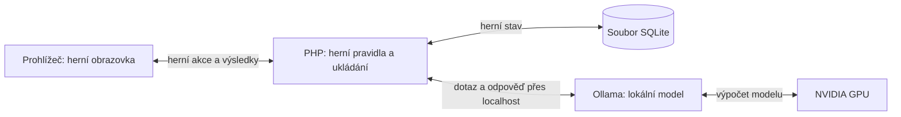

# Minilidi

**Fáze: návrh hry.** Zatím sbíráme nápady a kreslíme schémata. Herní koncept ani technologie nejsou uzavřené.

## Zadání

Vlastní minihra, kterou hráč otevře v prohlížeči a jejíž stav se ukládá do databáze. AI má pokud možno běžet lokálně na grafické kartě NVIDIA. Hru chceme používat bez vlastního instalátoru. Co hráč dělá a proč je k tomu AI užitečná, teprve určíme.

## Návrh technického uspořádání

- **Prohlížeč** zobrazuje hru a předává hráčovy akce.
- **PHP** obsluhuje hru, pracuje s uloženým stavem a v případě potřeby pošle dotaz na místní API Ollamy. Výpočet modelu na GPU zajišťuje Ollama; PHP ho nemusí umět provádět přímo.
- **Laragon** může na Windows zajistit webový server a PHP. Pro první verzi pro jednoho hráče je kandidátem **SQLite**: uložené hry jsou v souborové databázi a není potřeba spouštět MySQL. PHP k ní přistupuje přes PDO_SQLITE.
- **Ollama** potřebuje běžet na počítači s podporovanou GPU a ovladačem a mít stažený model. Model vybereme podle úlohy, paměti GPU a požadované rychlosti reakce.
- Pokud AI navrhuje herní akce, PHP nejprve ověří, zda je pravidla dovolují, a teprve pak upraví stav. Příklad pro případ, že hra bude mít postavy: AI napíše repliku a navrhne akci postavy, hra sama rozhodne, zda se akce smí stát.

## Co znamená bez instalace

| Varianta | Co hráč potřebuje | Poznámka |
| --- | --- | --- |
| Lokální web na vlastním PC | Prohlížeč, spuštěné PHP a Ollamu, stažený model | Pokud potřebné nástroje už na PC jsou, pro samotné Minilidi není nutná další instalace. Doporučený výchozí směr. |
| Přenosný balíček | Rozbalit připravené prostředí, spustit ho a otevřít stránku | Varianta pro pozdější návrh distribuce. Ovladač GPU musí být v systému a model musí být k dispozici. |
| Jen otevřít odkaz | Prohlížeč; PHP, databáze a AI běží na jiném počítači | Hráč nic místně nespouští. AI pak používá GPU počítače, kde běží model. |

Pokud by podmínkou bylo mít na hráčově PC **jen prohlížeč** a přitom počítat AI **na jeho GPU**, byl by to jiný návrh (např. model v prohlížeči přes WebGPU). Tuto variantu posoudíme, až budeme vědět, co má AI dělat. Pro výchozí návrh nativní aplikaci pro Windows nepotřebujeme.

## Co ujasníme dál

1. **Hráč:** Koho nebo co ovládá a čeho se snaží dosáhnout?
2. **První minuta hry:** Co hráč uvidí, jakou udělá první volbu a jak se projeví její výsledek?
3. **AI:** Ve kterém konkrétním okamžiku zlepší zážitek? Má tvořit dialogy, navrhovat chování postav, vymýšlet události, nebo dělat něco jiného?
4. **Rozsah:** Kolik má být postav či míst, jak hra plyne v čase a co se ukládá? Podle toho navrhneme první herní smyčku a obrazovky.

## Podklady

- [Ollama: lokální API](https://docs.ollama.com/api/introduction), [podpora GPU](https://docs.ollama.com/gpu) a [samostatné balíčky](https://github.com/ollama/ollama/releases)
- [Laragon: přenosné prostředí](https://laragon.org/docs/portable)
- [PHP: PDO_SQLITE](https://www.php.net/pdo-sqlite)

## Návrhová tabule

Spusť [SPUSTIT-TABULI.cmd](SPUSTIT-TABULI.cmd) a spouštěč otevře [místní tabuli](http://127.0.0.1:8091/) v prohlížeči. Využije existující PHP z Laragonu, poslouchá pouze na tomto počítači a funguje bez Ollamy. Po zavření okna „Minilidi - mistni server“ přestane být stránka dostupná; návrhy zůstanou uložené.

Karty se ukládají do [tabule/data/napady.json](tabule/data/napady.json). Pro další práci v Codexu je to zdroj návrhů. Před přímou úpravou souboru je potřeba načíst aktuální stav, aby se zachovaly změny z prohlížeče. Karta ve stavu „Dohodnuto“ zaznamenává návrhové rozhodnutí.

Pokud se místní web neotevře, otevři soubor [Minilidi.html](Minilidi.html) přímo z Průzkumníku. Tlačítkem **Otevřít soubor s nápady** vyber `tabule/data/napady.json`. Pokud prohlížeč povolí zápis, změny se uloží do tohoto souboru. Jinak použij **Stáhnout JSON** a staženým souborem nahraď původní `napady.json`.

## Hratelný prototyp

Dvojklikem otevři [SPUSTIT-MINILIDI.cmd](SPUSTIT-MINILIDI.cmd) a v okně Minilidi klikni na **Spustit**. Hra se otevře na [místní adrese](http://127.0.0.1:8093/). Tlačítko **Zastavit** i zavření okna ukončí web a simulaci. Tlačítko **Otevřít hru** znovu otevře prohlížeč. Stav obou vesnic se ukládá do SQLite.

Volba **Používat místní AI a GPU** zapíná samostatný proces Ollamy pro Minilidi. Při změně volby za běhu spouštěč krátce restartuje hru a naváže z uloženého stavu. Po vypnutí volby se proces Ollamy pro Minilidi ukončí a vesnice pokračují podle pravidel. Výchozí model je `gemma4:e4b`. Pokud model neodpoví, zvolí reakci hra. Model lze nastavit proměnnou `MINILIDI_MODEL`. Chyby PHP se zapisují do `prototyp/data/provoz-chyby.log`.

Klikni na postavu na mapě nebo pod ní a vyber vnuknutí. V kronice sleduj reakci i skutečné dokončení úkolu. Při filtrování na vybranou postavu uvidíš její historii. Herní den má 20 skutečných minut a třicetidenní měsíc 10 hodin. Společný ciferník ukazuje denní dobu, polohu v roce a počasí. Po delším uspání nebo vypnutí hra naváže z posledního uloženého času.

Při přímém spuštění `prototyp/spustit.php` přes PHP s rozšířeními pdo_sqlite a curl lze použít i místní LM Studio nebo llama.cpp s rozhraním OpenAI. V konzoli nastav `MINILIDI_AI=openai`, `MINILIDI_MODEL` na identifikátor modelu a případně `MINILIDI_AI_PORT`. Výchozí port tohoto rozhraní je 1234.

### Porovnání vesnic

Mapa i Přehled zobrazují vlevo vesnici s místní AI a vpravo vesnici řízenou pravidly. Pravá vesnice při prvním spuštění převezme stav levé a od té chvíle si ukládá vlastní zásoby, vztahy, úkoly i kroniku. Obě používají společný herní čas a stejné podmínky prací. Hráčovy zásahy se předávají do obou, pokud jsou pro danou postavu dostupné. Grafy počítají srovnání od společného začátku.

Kámen po těžbě čeká u lomu. Trakař odveze až 4 jednotky do vesnických zásob. Nový dům stojí 12 dřeva a 6 kamene. Pokud má vesnice volný dům a dost zásob, může se přistěhovat nový obyvatel.

### Dávkový plán a víra

Každých 6 herních hodin (5 skutečných minut) se připraví hlavní a případný druhý úkol pro postavy od 12 let. Přímé vnuknutí může dávku předběhnout. Dostupnost, spotřebu, únavu, vztahy a důsledky řídí PHP v obou vesnicích. Pokud model chybí nebo návrh pro postavu neprojde, práce se vybere podle skóre hry. Při nízké zábavě či náladě má přednost návštěva, při krajní únavě odpočinek. Počasí a zásoby mohou volbu změnit při zahájení úkolu. Přehled rozhodování je v záložce **Schéma**.

V záložce **Víra** jsou hnutí, jejich členové, zázraky, průměrná víra, strach, důvěra a poslední volání modelu. Tlačítko **Pozastavit AI** uloží pauzu i přes restart. Obě vesnice během pauzy pokračují podle pravidel. Zázrak se provádí za přízeň, jejíž stav si eviduje každá větev. Další zázrak lze použít po šesti herních hodinách.

| Nastavení | Výchozí hodnota |
|---|---|
| Kontext Ollamy · MINILIDI_NUM_CTX | 4096, nastavitelné do 8192 |
| Prodleva uvolnění modelu Ollamy · AI_KEEP_ALIVE | 5 sekund od odpovědi |
| Čas dávky · MINILIDI_BATCH_TIMEOUT_MS | 60000 ms |
| Čas vnuknutí · MINILIDI_FAST_TIMEOUT_MS | 12000 ms |
| MINILIDI_MIN_FREE_VRAM_MIB | vypnuto; po nastavení se volná VRAM zkontroluje před voláním Ollamy |
| MINILIDI_NO_AI | při hodnotě 1 rozhodují pravidla po celou dobu běhu |
| Zápis SQLite WAL · kontrolní bod | po každé překročené herní hodině |

Pro restart klikni na **Zastavit**, počkej na stav **Hra je zastavená** a klikni na **Spustit**. Existující databáze se načtou a doplní automaticky.

Testy modelu běží nad SQLite v paměti. S PHP z Laragonu s rozšířeními pdo_sqlite a curl spusť v prvním terminálu ze složky prototyp příkaz **php -S 127.0.0.1:18096 tests/model-stub.php**. Ve druhém spusť **php tests/overeni.php 18096 18097**, kde druhý port musí být volný.
